<p align="center">
  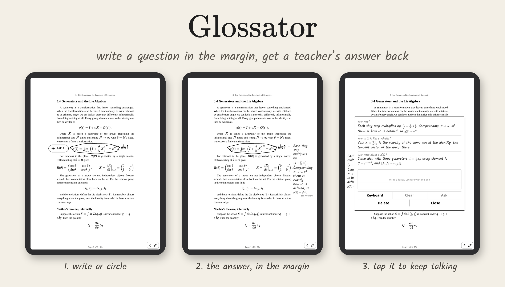
</p>

<p align="center">
  <b>A KOReader plugin for pen e-readers.</b><br>
  Write or circle on the page with the pen, tap <b>Ask AI</b>, and the answer is handwritten into the margin next to your ink, like a teacher's note, with real math.
</p>

<p align="center">
  
  
  
  
</p>

*A glossator was a medieval scholar who wrote explanations, "glosses", in the margins of books.*

---

**Contents**
[What it does](#what-it-does) ·
[Install](#install) ·
[Using Glossator](#using-glossator) ·
[Models and API keys](#models-and-api-keys) ·
[Sync notes to your notes app](#sync-your-notes-to-your-notes-app) ·
[Settings](#settings) ·
[Troubleshooting](#troubleshooting) ·
[Development](#development) ·
[Credits](#credits-and-license)

---

## What it does

| Write or circle, tap **Ask AI** | The answer, in the margin | Tap it: a conversation |
|:---:|:---:|:---:|
| 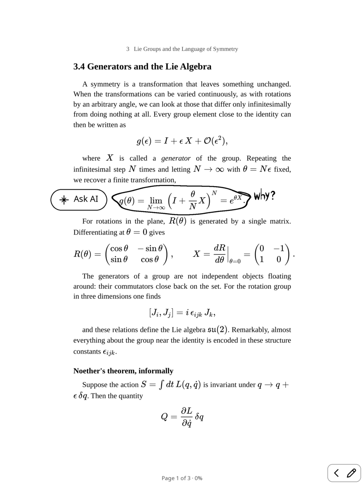 | 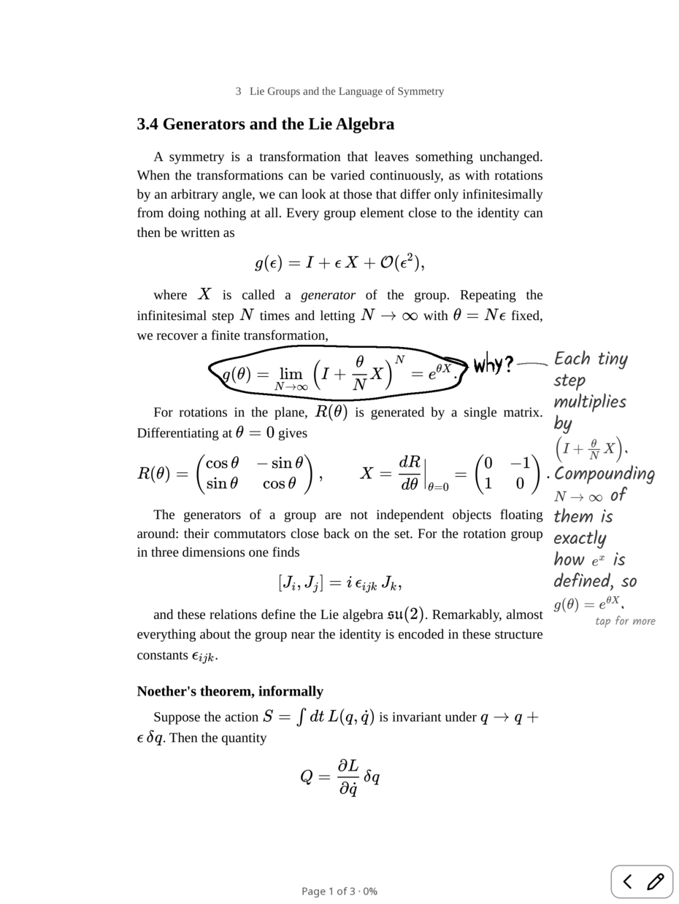 | 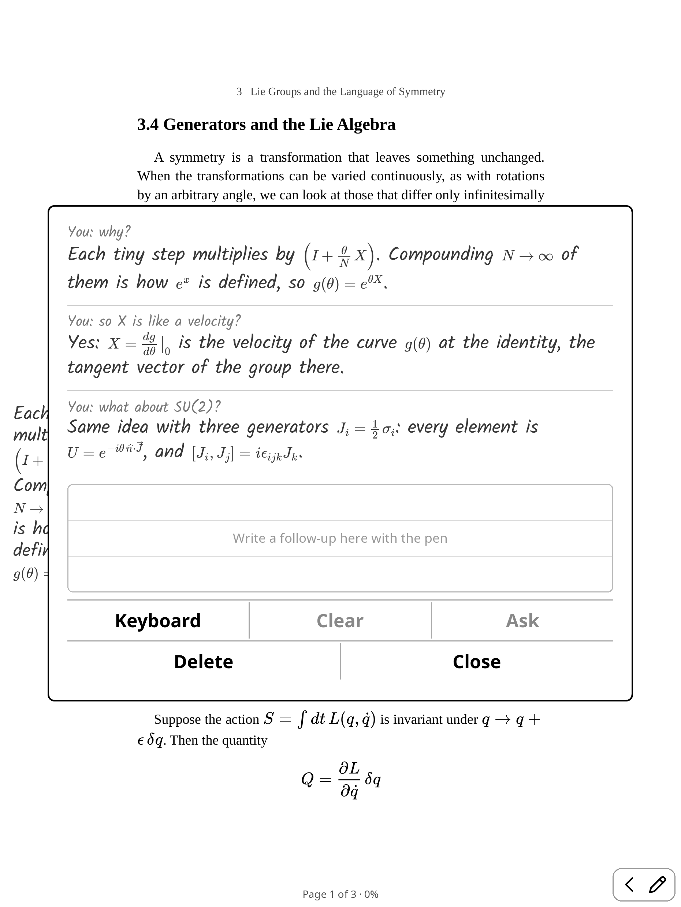 |

- **Ask about anything on the page.**
  - Circle a formula and write "why?".
  - Underline a sentence and write "example?".
  - Draw an arrow to a figure and ask what it shows.
- **The answer is written in the margin, like a teacher's note:**
  - in a handwriting font, next to your ink, in the nearest blank space
  - never over the text, figures or your own writing
  - math is properly typeset, offline, by Glossator's own small TeX engine
- **Keep the conversation going.** Tap the note to open it. Write a follow-up on the lined pad with the pen, or type it with the keyboard. The answer arrives in the same card.
- **Pick your model:** Claude with an Anthropic key, or Gemini, GPT, Grok, Mistral, Qwen and more with an OpenRouter key.
- **A real writing experience:** a natural pen line, a writing toolbar (pen, marker, eraser, lasso, undo), and your hand can rest on the glass while you write.
- **Your notes go where your notes live:** Readwise, Joplin, Nextcloud Notes, Markdown, through KOReader's own export.
- **A calm reading look:** one whole PDF page per screen, a clean top bar, a slim progress bar.

Everything stays in the book: notes and ink are saved with it and anchored to the text, so they come back when you reopen it.

---

## Install

You need three things:
1. **A jailbroken Kindle.** Glossator was made on a Kindle Scribe.
2. **KOReader.**
3. **An API key** from Anthropic or OpenRouter.

Glossator is a KOReader plugin, so it should also work on other devices that run KOReader. The pen features need a pen device, and only the Kindle Scribe has been tested.

### Step 1. Jailbreak your Kindle

Follow the community guide at **[kindlemodding.org](https://kindlemodding.org/jailbreaking/index.html)**. Before you start:

- **Read the whole guide first.** Then use the **[jailbreak wizard](https://kindlemodding.org/jailbreak-wizard.html)** to find the jailbreak for your model and firmware.
- **Don't let the Kindle update** while you prepare. The guide shows you how to [prevent automatic updates](https://kindlemodding.org/jailbreaking/prevent-auto-update/).
- **A jailbreak only works on certain firmware versions.** Amazon patches them, so if yours isn't supported yet, you may have to wait.
- **If you get stuck,** ask the [KindleModding Discord](https://discord.kindlemodding.org/) or [r/kindlejailbreak](https://www.reddit.com/r/kindlejailbreak/). Don't factory-reset a jailbroken Kindle on a whim.

After jailbreaking, the guide's [What's next](https://kindlemodding.org/jailbreaking/whats-next/index.html) section sets up **KPM**, the Kindle Package Manager. You'll use it for the next two steps.

### Step 2. Install KOReader

See [Getting KOReader](https://kindlemodding.org/jailbreaking/whats-next/getting-koreader/). In short, with Wi-Fi on, type these into the **search bar on the Kindle's home screen**, one at a time, pressing Enter after each:

```
;kpm update
```
```
;kpm install koreader
```

A KOReader icon appears on the home screen. Open KOReader once, then close it.

### Step 3. Install Glossator

**With KPM.** In the home-screen search bar, add Glossator's package source (once), update, and install:

```
;kpm add-repo https://raw.githubusercontent.com/NavidArd/glossator/main/kpm/manifest.v2.json
```
```
;kpm update
```
```
;kpm install glossator
```

The address is long to type on the Kindle's keyboard: check it carefully. If your search bar doesn't take it, run the same commands without the `;` in a terminal such as kTerm (`;kpm install kterm`).

**Or by hand, over USB:**
1. Download this repository: green **Code** button → **Download ZIP**. Unzip it.
2. Plug the Kindle into your computer and open the `koreader/plugins/` folder on it.
3. Copy the `glossator.koplugin` folder into it.
   - **Windows:** copying over an older copy can fail, so delete the old folder first.

### Step 4. Add your API key

Create a text file named **`glossator_key.txt`** in the Kindle's `koreader/` folder (next to `plugins/`). Put your key in it on one line:

- **An Anthropic key** (`sk-ant-…`, from [console.anthropic.com](https://console.anthropic.com/)) for Claude.
- **An OpenRouter key** (`sk-or-…`, from [openrouter.ai/keys](https://openrouter.ai/keys)) for Gemini, GPT, Grok, Mistral, Qwen and Claude. It's one key for all of them.

You can put both, one per line. See [Models and API keys](#models-and-api-keys).

### Step 5. Restart KOReader

Open a book. Everything is under **Tools → Glossator**. Write on the page with the pen, and an **Ask AI** chip appears when you pause.

### Updating and removing

| | With KPM | By hand |
|---|---|---|
| **Update** | `;kpm update`, then `;kpm upgrade` | Replace the `glossator.koplugin` folder |
| **Remove** | `;kpm uninstall glossator` | Delete the `glossator.koplugin` folder |

Updating or removing never touches your notes, your ink or your key file.

---

## Using Glossator

### Asking

1. **Write or circle on the page with the pen.** Fingers still turn pages and open menus.
2. **Pause.** About a second and a half after you lift the pen (longer while it hovers), an **Ask AI** chip appears. It sits above or to the left of your ink, never where you'd write next, and hides as soon as you write again.
3. **Tap the chip.** You can keep reading while the answer is on its way: it runs in the background.
4. **The answer is written next to your ink,** with a thin pencil line to it when there's blank space for one.

Tap elsewhere, or ignore the chip, and your ink stays as a plain annotation.

The model sees three things:
- the page with your ink on it
- a close-up of your ink
- the page's text

So "why?" next to a circled equation is enough.

| Math, typeset offline | Ask about selected text |
|:---:|:---:|
| 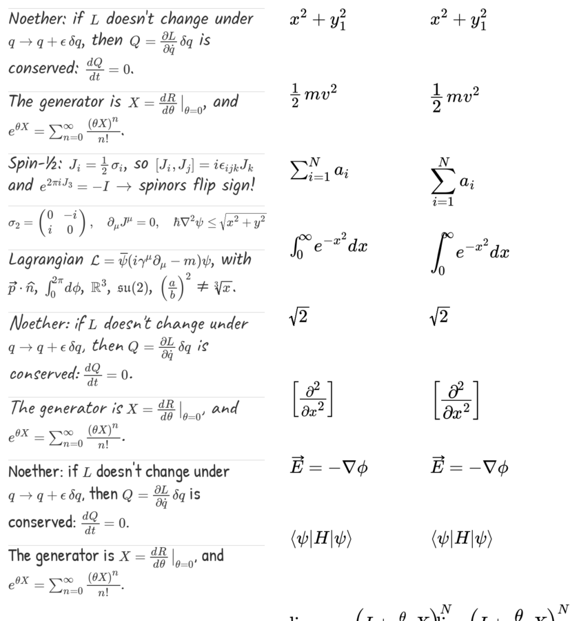 | 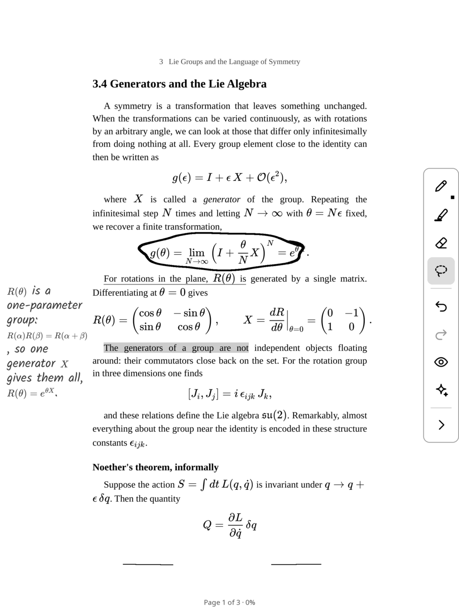 |

**Also:**
- **Ask about selected text:** select text with a finger, or hold the pen still on a word, and tap **Ask AI** in the popup.
- **Explain this page:** from the AI button in the top bar, or the menu.

### Conversations in the note

Tap a note to open it as a card with the whole conversation.

| Write a follow-up on the pad | Or type it |
|:---:|:---:|
| 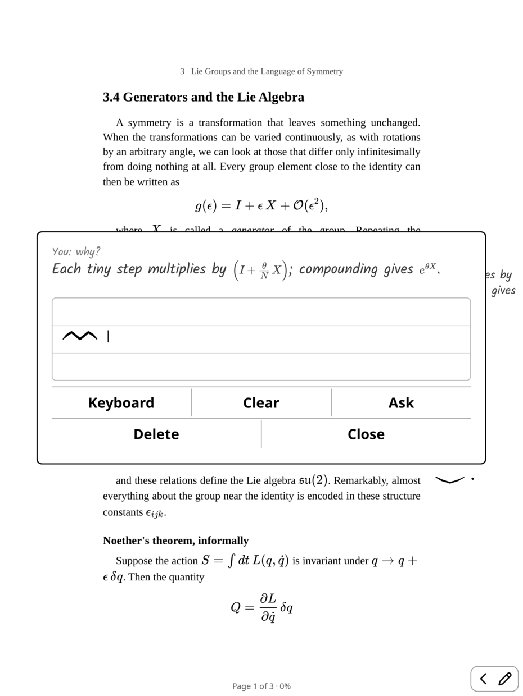 | 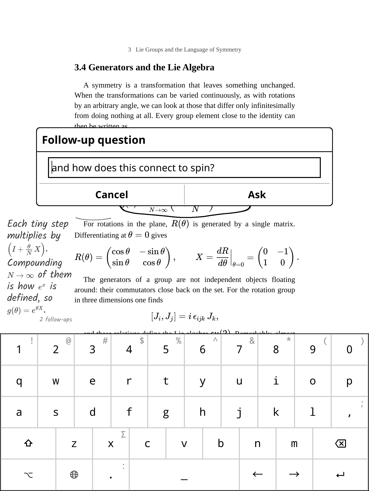 |

- **Write:** write your follow-up on the lined pad with the pen, then tap **Ask**.
- **Type:** tap **Keyboard** to type it instead.
- **The answer arrives in the same card,** and the model sees the earlier exchange.
- **Close** returns you to the page. The note there shows "2 follow-ups".

### Writing

| Pen widths | Marker → a real highlight | Lasso |
|:---:|:---:|:---:|
| 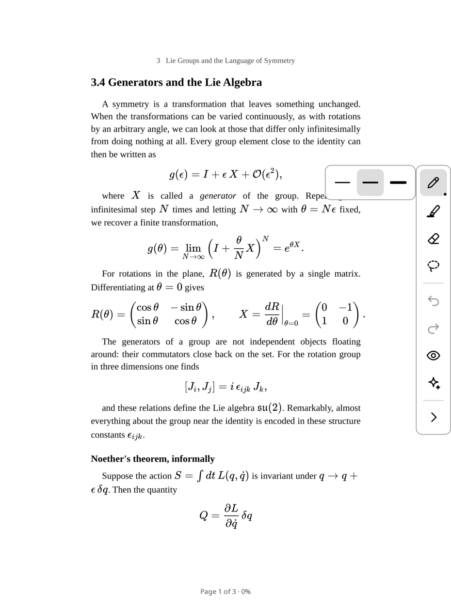 | 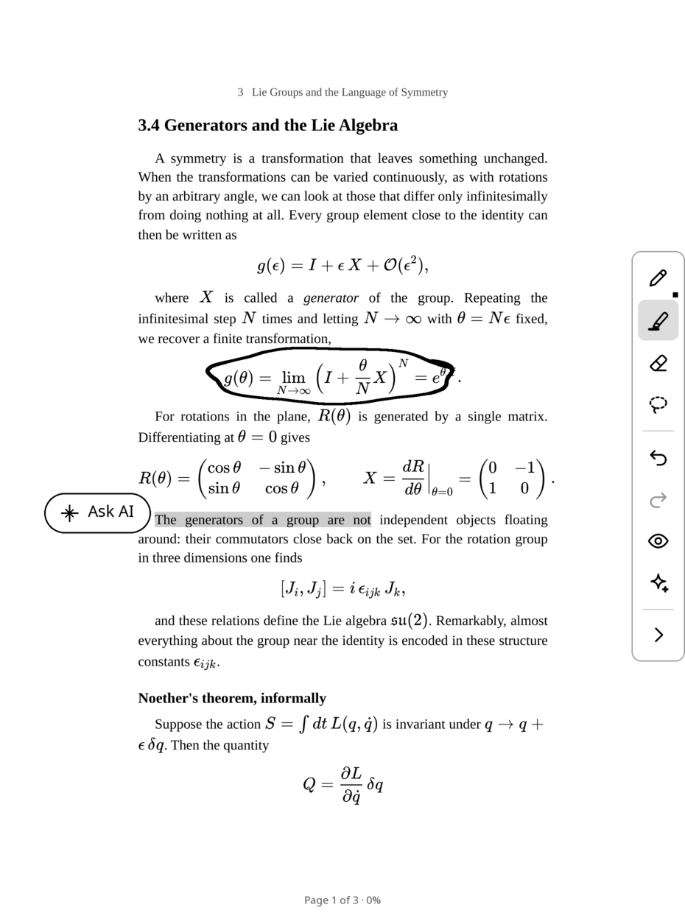 | 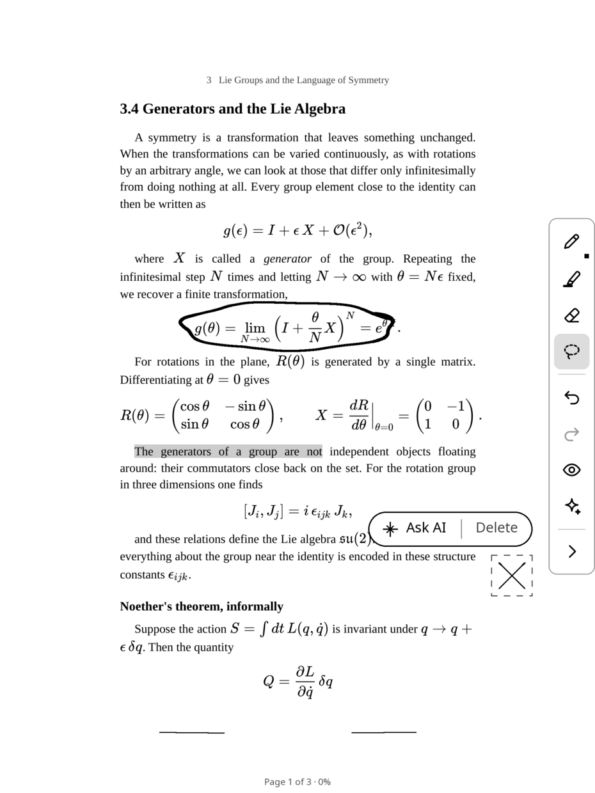 |

The **writing toolbar** sits on the page edge and folds into a small pill in the corner:

- **Pen:**
  - fine, medium or bold, in real millimetres
  - thins a little when you write fast, tapers at both ends, smoothed when you lift
  - a **pencil** style too
- **Marker:** a stroke along a line of text becomes KOReader's own highlight of it, and the chip offers to explain it.
- **Eraser:** whole strokes, or precise, which splits a stroke where it passes. The **pen's eraser end** erases too.
- **Lasso:** circle ink to select it. Then drag it, delete it, or ask about just that ink.
- **Undo, redo,** and **show or hide** all ink.

**Pen taps act like a finger.** A quick tap turns the page or presses a button. A dot right after writing (the dot of an *i*) stays ink. Holding the pen still on a word selects it.

**Your hand can rest on the glass.**
- **No stray lines:** on the Scribe, the pen and the touch panel share one input channel, and a resting palm can steal the pen's position or swallow its lift. Glossator keeps the pen on a channel of its own, so the palm never draws.
- **No accidental page turns:** while you write, and for a moment after, a touch from your wrist doesn't turn the page.

### The reading look

| Top bar | One whole PDF page per screen |
|:---:|:---:|
| 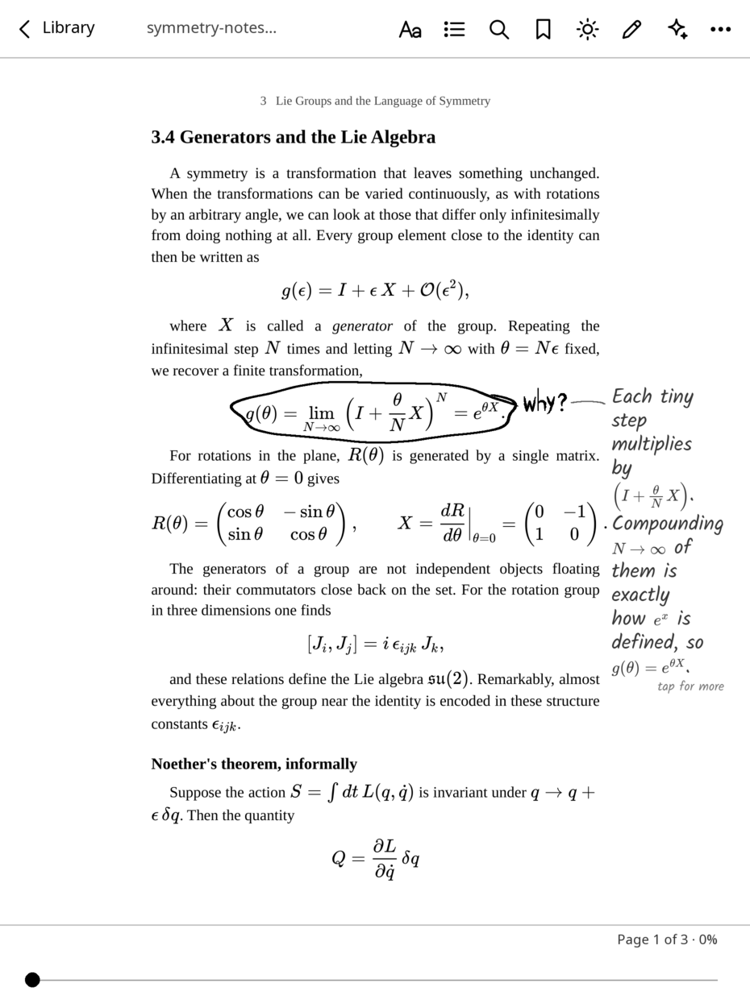 | 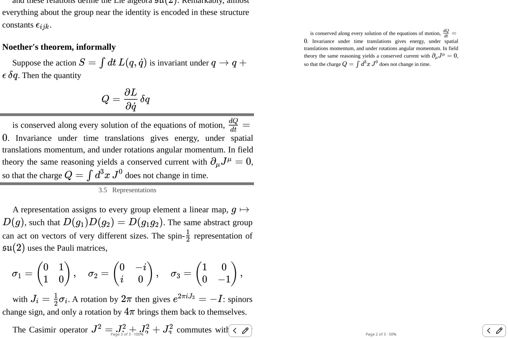 |

- **PDFs show one whole page per screen,** like a dedicated e-reader, and one tap is one page. KOReader's usual continuous scroll shows half of one page and half of the next.
- **Top bar** (tap the top of the page): library, font and layout, contents, search, bookmark, light, pen toolbar, AI, and KOReader's full menu.
- **Bottom bar and footer:**
  - a slim progress bar you can tap to jump
  - "Page x of y · z%", on one line
- **Tap zones:** the left fifth of the page goes back; the rest goes forward.
- **The book's cover** on the sleep screen, and a calmer refresh.

Each piece can be turned off in **Tools → Glossator → Reading look**.

---

## Models and API keys

Glossator reads `koreader/glossator_key.txt`, one key per line, and tells them apart by how they start. Choose the model in **Tools → Glossator → Writing and AI → Model**.

<p align="center">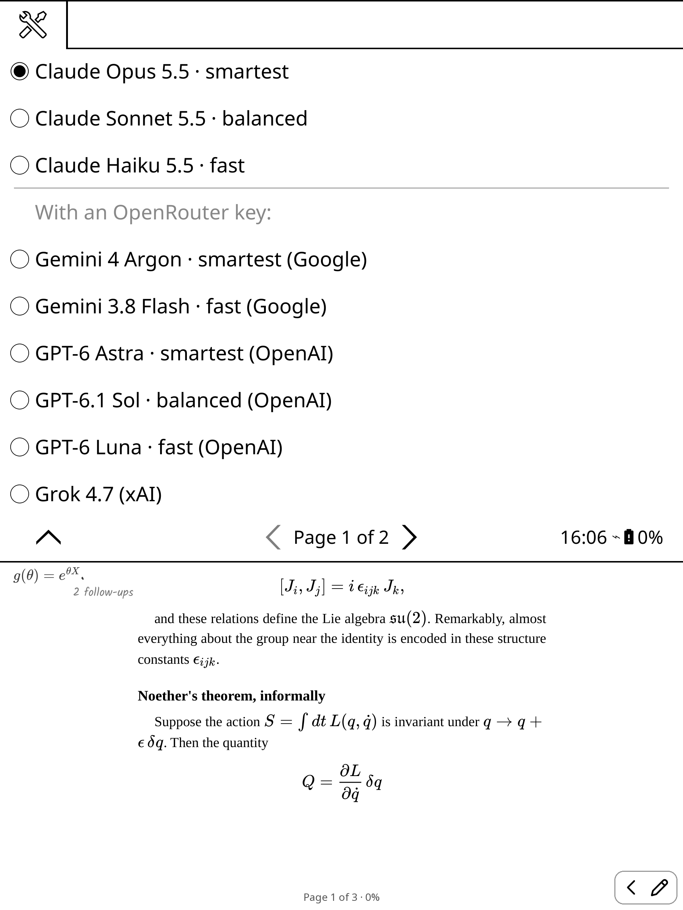</p>

| | Smartest | Fast |
|---|---|---|
| **Claude** (Anthropic or OpenRouter key) | Opus 5.5, Sonnet 5.5 | Haiku 5.5 |
| **Google** (OpenRouter key) | Gemini 4 Argon | Gemini 3.8 Flash |
| **OpenAI** (OpenRouter key) | GPT-6 Astra, GPT-6.1 Sol | GPT-6 Luna |
| **Also** (OpenRouter key) | Grok 4.7, Mistral Large 4 | Qwen3.8 Flash |

- **More models → Get the newest models** fetches the newest few from each big provider on OpenRouter.
- **Type a model ID** takes any model from [openrouter.ai/models](https://openrouter.ai/models) that reads images.
- **With only an OpenRouter key,** the Claude choices go through OpenRouter.

### What is sent, and where

When you ask, Glossator sends the provider you chose:
- an image of the page with your ink
- a close-up of the ink
- the page's text
- for follow-ups, the earlier exchange

Nothing is sent until you tap **Ask AI**, and nothing goes anywhere else.

### Is the key safe?

- **It's stored as plain text** on the e-reader, like Wi-Fi passwords and other KOReader logins. Encrypting it wouldn't help, because the key to decrypt it would have to sit on the same device.
- **It's protected on the network.** KOReader's built-in HTTPS doesn't check certificates. Glossator checks every server's certificate and name itself, and refuses to send anything otherwise. Someone on the same Wi-Fi can't pose as the server to read your key.
- **It's never written** to a log or an export.

Two precautions are worth taking:
- **Give the key a spending limit:** OpenRouter keys can have a credit limit, and Anthropic has monthly limits per workspace.
- **Revoke it if you lose the device:** anyone who has the e-reader can read the file.

---

## Sync your notes to your notes app

Glossator's notes go through **KOReader's own Export highlights** (Tools → Export highlights). It can send to:

- Readwise
- Joplin
- Nextcloud Notes
- Markdown, HTML, JSON or plain text files
- XMNote
- My Clippings

**Readwise** goes on to Notion, Obsidian, Logseq, Roam, Evernote and others.

Each AI note is exported as:
- **the highlight:** what you asked: the selected text, or your handwritten question as the model read it
- **its note:** the answer, the longer explanation and the follow-ups

Notes are exported in page order, next to your ordinary highlights, with math kept as LaTeX.

```markdown
### Page 12 @ 04 November 2026 04:03:41 PM
*why is this conserved?*

---
Because the action is invariant: $\delta S = 0 \Rightarrow \dot Q = 0$.

Q: and for SU(2)?

A: Same, with $J_i = \tfrac12\sigma_i$.
```

To set it up:
1. In KOReader, go to **Tools → Export highlights → Choose formats and services** and turn on your target (Readwise needs its access token, Joplin its token, and so on).
2. Choose **Export all notes in current book** or **Export all notes in all books in history**.

To leave AI notes out, turn off **Include AI notes in Export highlights** in Glossator's menu.

Glossator also has its own **Export notes (Markdown)**, one file per book in `koreader/glossator_exports/`.

---

## Settings

**Tools → Glossator → Writing and AI**

| Setting | What it does |
|---|---|
| **Model** | Which AI answers (see above) |
| **Pen, Style, Eraser** | Pen width; ink pen or pencil; whole-stroke or precise eraser |
| **Quick pen taps turn pages** | A quick pen tap acts like a finger. Off: every touch of the pen is ink |
| **Ignore the hand while writing** | Wrist touches don't turn pages while you write |
| **Keep the pen apart from the hand** | The pen bridge that stops a resting palm from drawing (on by default) |
| **Pen pressure (experimental)** | The line follows how hard you press |
| **Handwriting of the notes, Size of the notes** | The note's font (Kalam, Caveat, Patrick Hand) and size |
| **Explain this page** | Ask about the whole page |
| **Export notes (Markdown)** | One Markdown file per book |
| **Include AI notes in Export highlights** | Send notes along with KOReader's export (on by default) |
| **Reset (if something gets stuck)** | Clears any stuck state |
| **Delete all ink and notes in this book** | Starts the book over |

**Tools → Glossator → Reading look** turns each part of the reading look on or off.

---

## Troubleshooting

- **Something seems stuck:** use Tools → Glossator → Writing and AI → **Reset**. Glossator's drawing and timers are guarded, so an error is logged to `koreader/crash.log` and can't freeze the reader.
- **"Put your API key in…":**
  - Check that the file is named exactly `glossator_key.txt` and sits in the `koreader/` folder, not in `plugins/`.
  - **Windows** may have saved it as `glossator_key.txt.txt`.
- **Gemini or GPT says it needs an OpenRouter key:** those models only work through OpenRouter. Add an `sk-or-…` key on its own line.
- **Stray lines while the palm rests:** make sure **Keep the pen apart from the hand** is on, then restart KOReader.
- **Do I need Ink Away?** No. Glossator includes the parts of [Ink Away](https://github.com/EmirErtorer/ink-away.koplugin) it uses. If you keep Ink Away installed, they get along. Ink you drew with Ink Away stays in Ink Away's own files.
- **KPM says "Could not find artifact for given target":** KPM doesn't know Glossator's package source yet. Its log then shows only the official list (`repo.kindlemodding.org`).
  1. Run the `;kpm add-repo …` line from [Step 3](#step-3-install-glossator).
  2. Check it with `;kpm list-repo`: Glossator should be listed.
  3. Run `;kpm install glossator` again.
- **The `;kpm` command does nothing:** make sure Wi-Fi is on and you ran `;kpm update` first. See [kindlemodding.org](https://kindlemodding.org/jailbreaking/whats-next/index.html) for KPM itself.

Found a bug? [Open an issue](https://github.com/NavidArd/glossator/issues) with your device, KOReader version and, if there is one, `koreader/crash.log`.

---

## Development

```
glossator.koplugin/        the plugin
  main.lua                 menu, and the two parts below
  glossator/ink.lua        pen, ink, asking, notes
  glossator/look.lua       the reading look
  glossator/claude.lua     Anthropic and OpenRouter requests (certificate-checked)
  glossator/math.lua       the small TeX math engine
  glossator/exporthook.lua notes in KOReader's Export highlights
kpm/                       the KPM package source and package repository
tools/build-kpm.py         builds the .kpkg and updates kpm/manifest.v2.json
tools/emulator/            KOReader's Linux build, headless, with scripted pen input
```

**Tests.** `tools/emulator/` runs KOReader's Linux build headless with scripted pen input; see its README. The scenarios cover:
- asking and follow-ups
- the toolbar and the palm guard
- the keyboard and export
- a replay of Kindle Scribe pen and palm input through KOReader's real input code

**Releasing a version:**
1. Bump `version` in `glossator.koplugin/_meta.lua`.
2. Run `python3 tools/build-kpm.py`.
3. Commit the new `.kpkg` and `kpm/manifest.v2.json`. KPM users get it with `;kpm upgrade`.

---

## Credits and license

- **Glossator** is released under the [MIT license](LICENSE).
- **Pen handling** (palm rejection, the pen bridge) and the drawing approach are from [Ink Away](https://github.com/EmirErtorer/ink-away.koplugin) by Emir Devlet Ertörer (MIT). The pen bridge follows pierspad's [Notebook](https://github.com/pierspad/notebook.koplugin) plugin (MIT).
- **Fonts:** Kalam, Caveat, Patrick Hand, and KaTeX's math fonts, all under the SIL Open Font License 1.1.
- **[KOReader](https://github.com/koreader/koreader)** (AGPL-3.0), **[KPM](https://github.com/KindleModding/KPM)** and the **[KindleModding](https://kindlemodding.org)** community make all of this possible.

See [`glossator.koplugin/NOTICE.md`](glossator.koplugin/NOTICE.md) and `glossator.koplugin/fonts/OFL-*.txt`.

Glossator is an independent project, not affiliated with Amazon, Anthropic, OpenRouter, Google, OpenAI or the KOReader project. Kindle and Kindle Scribe are trademarks of Amazon.com, Inc. Jailbreaking your device is at your own risk.
